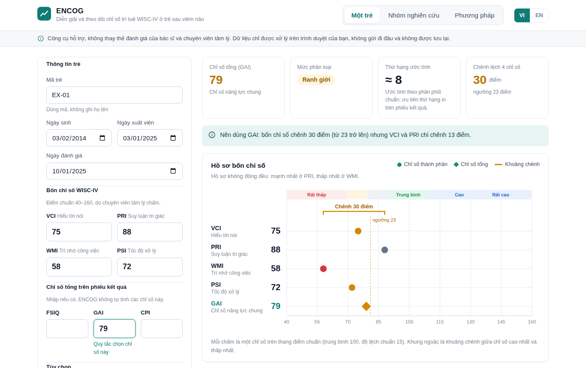
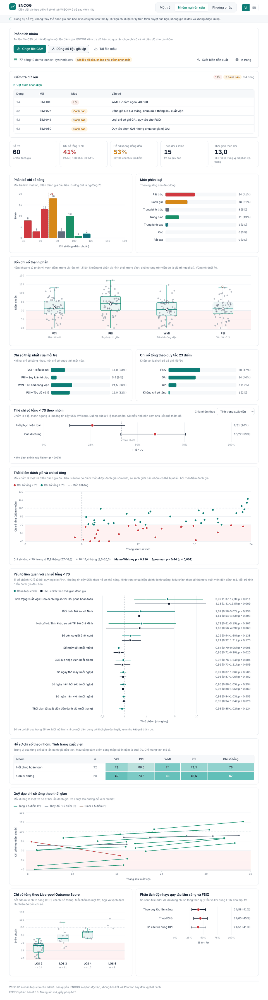

# ENCOG

**Công cụ hỗ trợ diễn giải và theo dõi chỉ số trí tuệ WISC-IV ở trẻ sau viêm não**
*A support tool for interpreting and following WISC-IV index scores in children after encephalitis*

[](https://github.com/YOUR-GITHUB-USERNAME/encog/actions/workflows/ci.yml)
<!-- Sau khi Zenodo cấp DOI, thay dòng dưới bằng badge DOI thật -->
DOI 0.3.0: [10.5281/zenodo.23329825](https://doi.org/10.5281/zenodo.23329825). DOI 0.4.0: xem bản phát hành v0.4.0 trên Zenodo.

Dùng trực tuyến / Use online: `https://YOUR-GITHUB-USERNAME.github.io/encog/`

> ENCOG là **công cụ hỗ trợ**. Không thay thế đánh giá của bác sĩ và chuyên viên tâm lý, không chẩn đoán. Điểm chỉ số phải do người đã được đào tạo chấm bằng bộ WISC-IV có bản quyền. ENCOG không chứa câu hỏi, dụng cụ hay bảng chuẩn của WISC-IV và không liên kết với Pearson.

---

## Tiếng Việt

### ENCOG làm gì

**Một trẻ**
- Nhập 4 chỉ số (VCI, PRI, WMI, PSI) và chỉ số tổng trên phiếu kết quả (FSIQ, GAI, CPI nếu có).
- Áp quy tắc chênh lệch 23 điểm để cho biết nên dùng FSIQ, GAI hay diễn giải hồ sơ 4 chỉ số (từ 0.4.0, CPI chỉ là điểm bổ sung, không thay thế FSIQ/GAI).
- Vẽ "thước điểm chuẩn": vị trí 4 chỉ số, khoảng chênh và ngưỡng.
- Chỉ ra lĩnh vực cần hỗ trợ kèm gợi ý cho gia đình, nhà trường.
- Kiểm tra thời điểm (≥ 6 tháng sau xuất viện, tuổi 6:0–16:11) và đề xuất ngày đánh giá lại.
- In 3 loại báo cáo: cho gia đình, cho nhà trường (không ghi điểm), chuyên môn.
- Lưu và mở hồ sơ dạng `.json` trên máy của bạn.

**Nhóm nghiên cứu**
- Đọc file CSV (cột tiếng Việt hoặc tiếng Anh, dấu phẩy hoặc chấm phẩy).
- Kiểm tra dữ liệu: điểm ngoài khoảng, ngày sai thứ tự, đánh giá sớm, trùng dòng, loại chỉ số ghi khác quy tắc.
- Thẻ tóm tắt và biểu đồ: phân bố chỉ số tổng, mức phân loại, 4 chỉ số, chỉ số thấp nhất, loại chỉ số tổng, tỉ lệ < 70 theo nhóm (KTC 95% Wilson, Fisher), quỹ đạo theo thời gian, chỉ số tổng theo Liverpool Outcome Score, phân tích độ nhạy với FSIQ và khi bỏ CPI.
- **Mới ở 0.3.0:** thời điểm đánh giá so với chỉ số tổng (Mann–Whitney, Spearman); yếu tố liên quan với chỉ số tổng < 70 bằng hồi quy logistic Firth, trước và sau hiệu chỉnh theo thời gian đánh giá; hồ sơ chỉ số theo nhóm; biến lâm sàng dạng số (số cơn co giật, số ngày sốt, GCS, số ngày thở máy, nằm hồi sức, nằm viện).
- Xuất biến dẫn xuất (`encog-derived.csv`) để phân tích bằng Stata, R, SPSS.
- Có sẵn bộ dữ liệu **giả lập** 60 trẻ để thử.




### Ngôn ngữ và mã hóa dữ liệu

ENCOG **ưu tiên tiếng Anh** cho dữ liệu: tên biến và giá trị phân loại được lưu, xuất bằng mã tiếng Anh (`discharge_status = full_recovery / sequelae`…). Giao diện tiếng Việt hiển thị nhãn tiếng Việt, giao diện tiếng Anh hiển thị nhãn tiếng Anh. File CSV ghi tiếng Việt vẫn đọc được và được quy đổi tự động. Xem [`docs/DATA_DICTIONARY.md`](docs/DATA_DICTIONARY.md).

### Quyền riêng tư

Mọi xử lý diễn ra trên trình duyệt. ENCOG không có máy chủ, không gửi và không lưu dữ liệu. **Không bao giờ đưa dữ liệu bệnh nhân thật vào kho mã này**, kể cả khi đã bỏ tên.

### Công nghệ

React 18 + TypeScript (`strict`), Vite. Không dùng thư viện biểu đồ ngoài: các biểu đồ là component SVG tự viết, tự co giãn theo khung và có tooltip.

```
src/
  types.ts            khai báo kiểu dùng chung (điểm, phân tích, bản ghi nhóm, báo cáo…)
  core/               logic thuần, không phụ thuộc React: wisc, followup, stats, regression (Firth), csv, cohort, report, variables (mã tiếng Anh)
  i18n/               vi.ts (định nghĩa kiểu Dict), en.ts (kiểu Dict), index.ts
  context/            LanguageContext
  hooks/              useElementWidth (ResizeObserver)
  components/
    layout/           Header, Footer
    common/           Button, Card, Field, Badge, Stat, Callout, EmptyState, icons
    charts/           ChartFrame (tooltip, legend), ScoreRuler, Histogram, BarList, BoxPlot, ForestPlot, Trajectories,
                      TimingScatter, OddsForest, ProfileHeatmap
    single/           SingleCasePage, CaseFormPanel, ResultPanel
    cohort/           CohortPage, DataCheck, CohortCharts
    report/           ReportView
    method/           MethodPage
  styles/index.css    giao diện nền trắng, quy tắc in
tests/                55 bài kiểm thử (node:test + tsx)
scripts/              make-synthetic.ts (tạo dữ liệu giả lập)
```

### Chạy trên máy

Cần Node.js ≥ 20.

```bash
npm install
npm run dev          # mở http://localhost:5173
npm run typecheck    # kiểm tra kiểu TypeScript
npm test             # 66 bài kiểm thử (gồm bộ kiểm chứng độc lập tests/verification.test.ts)
npm run build        # kiểm tra kiểu rồi tạo thư mục dist/
```

### Đưa lên GitHub và Zenodo

1. Tạo kho mã công khai tên `encog` trên GitHub (hoặc dùng kho đã có), rồi đẩy mã lên:
   ```bash
   git init && git add . && git commit -m "ENCOG 0.4.0"
   git branch -M main
   git remote add origin https://github.com/YOUR-GITHUB-USERNAME/encog.git
   git push -u origin main
   ```
   Nếu kho đã có sẵn: chép đè các file này vào kho, rồi `git add -A && git commit -m "ENCOG 0.4.0" && git push`.
2. Bật GitHub Pages: **Settings → Pages → Build and deployment → Source: GitHub Actions**. Workflow `ci.yml` chạy kiểm tra kiểu và 66 bài kiểm thử; `deploy.yml` build và đưa app lên `https://YOUR-GITHUB-USERNAME.github.io/encog/`.
3. Kết nối Zenodo: đăng nhập [zenodo.org](https://zenodo.org), vào **GitHub** trong menu tài khoản, bật công tắc cho kho `encog` (làm **trước** khi tạo bản phát hành).
4. Tạo bản phát hành trên GitHub: **Releases → Draft a new release → tag `v0.4.0`**, tiêu đề `ENCOG 0.4.0`, dán mục 0.4.0 trong `CHANGELOG.md`. Zenodo tự lưu trữ và cấp DOI, đọc thông tin từ `.zenodo.json`.
5. Lưu ý: bản 0.3.0 (DOI 10.5281/zenodo.23329825) được tải lên Zenodo bằng tay, nên bản phát hành từ GitHub sẽ là một bản ghi Zenodo mới; `.zenodo.json` đã khai báo quan hệ *isNewVersionOf* tới DOI 0.3.0. Muốn giữ chung một bản ghi (cùng "concept DOI") thì thay vì bước 3–4, vào bản ghi 0.3.0 → **New version** → tải lên file zip của bản phát hành.
6. Thay `YOUR-GITHUB-USERNAME` trong `README.md`, thêm badge DOI, rồi đẩy lại.

### Tài liệu

- [`docs/METHODS.md`](docs/METHODS.md) – quy tắc, ngưỡng, thống kê, kiểm tra dữ liệu, hạn chế.
- [`docs/DATA_DICTIONARY.md`](docs/DATA_DICTIONARY.md) – định dạng CSV và biến dẫn xuất.
- [`docs/VALIDATION_PLAN.md`](docs/VALIDATION_PLAN.md) – đánh giá tiền pha 2 và kế hoạch pha 2.
- [`docs/LITERATURE.md`](docs/LITERATURE.md) – tổng quan y văn: công cụ phối hợp và nguồn dữ liệu bổ sung.

### Bài báo liên quan

Vương HBC, Phùng NTN, Đặng QD, et al. *Intellectual functioning after encephalitis requiring intensive care in Vietnamese children: a WISC-IV follow-up study.* Bản thảo gửi Pediatric Neurology, 2026. ENCOG 0.3.0 cài đặt các phân tích của bài (chỉ số tổng theo quy tắc 23 điểm, thời điểm đánh giá, hồi quy Firth hiệu chỉnh theo thời gian đánh giá). ENCOG 0.4.0 sửa quy tắc CPI và lịch đánh giá lại theo nhận xét phản biện.

### Trích dẫn

Xem [`CITATION.cff`](CITATION.cff) hoặc nút "Cite this repository" trên GitHub.

---

## English

### What ENCOG does

**One child:** enter the four WISC-IV indexes and any summary index from the score report; ENCOG applies the 23-point discrepancy rule (FSIQ → GAI → four-index profile; since 0.4.0 the CPI is only a supplementary score), draws the four indexes on the standard-score scale, lists areas needing support with classroom and home suggestions, checks timing (≥ 6 months after discharge, age 6:0–16:11), proposes a re-assessment date, and prints family, school (no scores) and clinical reports.

**Study cohort:** upload a CSV (Vietnamese or English headers); ENCOG checks the data, then summarises the cohort with cards and charts (distribution, bands, four-index profile, lowest index, summary-index type, proportion below 70 by group with Wilson CIs and Fisher's test, trajectories, Liverpool Outcome Score, FSIQ and excluding-CPI sensitivity analyses, assessment timing vs summary index, Firth logistic regression for factors associated with a summary index < 70 before and after adjustment for assessment timing, index profiles by group) and exports derived variables for Stata/R/SPSS. A synthetic 60-child dataset is built in.

**Language:** data are English-first (canonical English variable names and codes); the UI translates labels into the selected language, and Vietnamese input files are mapped to the codes automatically. **Privacy:** everything runs in the browser; nothing is stored or sent. Never commit real patient data to this repository.

**Stack:** React 18 + strict TypeScript + Vite; hand-written responsive SVG charts with tooltips. **Run locally:** `npm install`, `npm run dev`, `npm run typecheck`, `npm test`, `npm run build` (Node.js ≥ 20).

**Release:** push to GitHub, enable Pages with GitHub Actions, connect the repository in Zenodo, then publish release `v0.4.0` to mint a DOI (metadata from `.zenodo.json`, declared as a new version of 10.5281/zenodo.23329825). Alternatively, upload the release zip as a *New version* of the 0.3.0 Zenodo record to keep a single concept DOI. See the Vietnamese steps above.

## Giấy phép / License

Mã nguồn: MIT (xem [`LICENSE`](LICENSE)). WISC-IV là nhãn hiệu của chủ sở hữu bản quyền; tên được dùng chỉ để mô tả loại điểm mà công cụ nhận vào.
